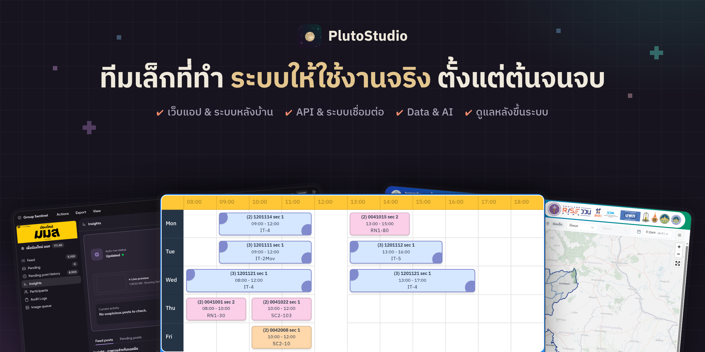
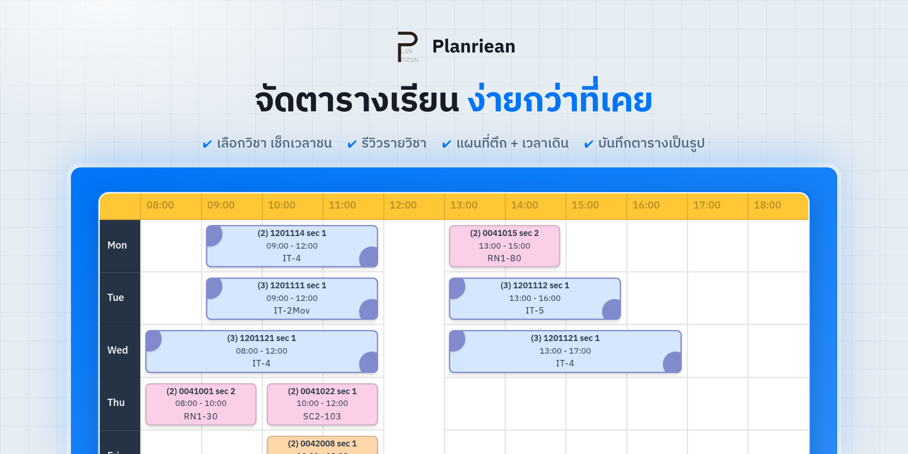
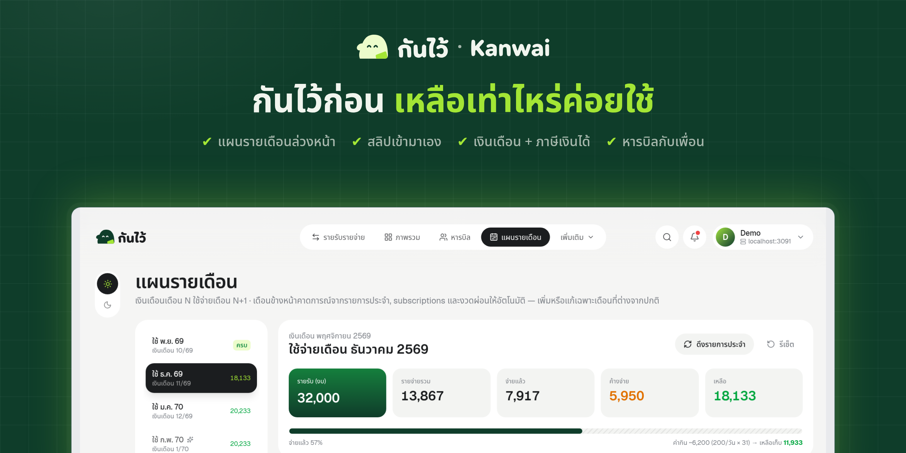
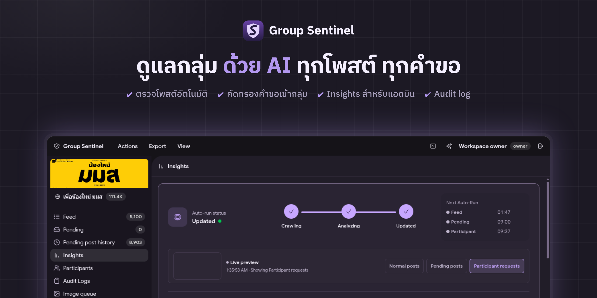
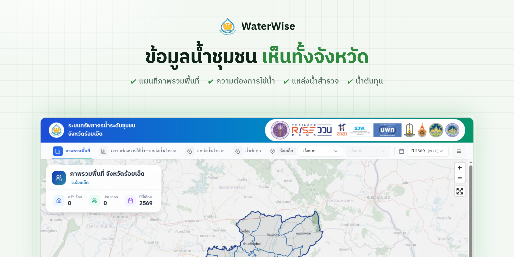
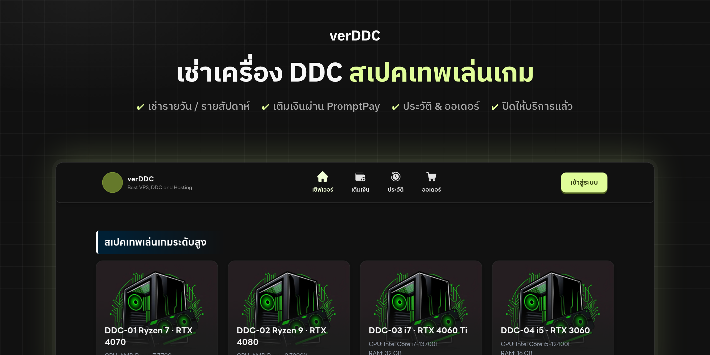
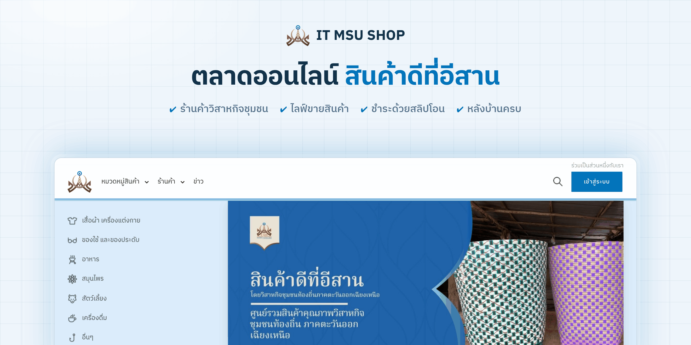
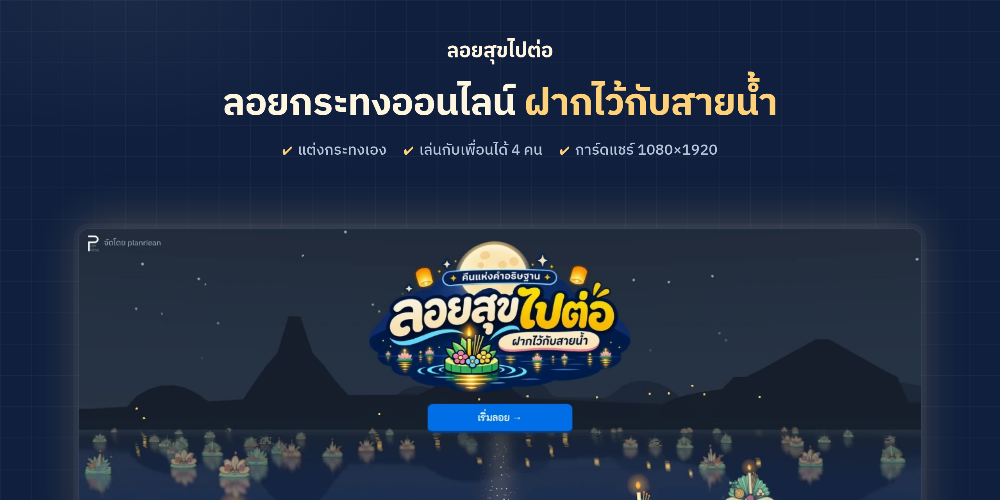
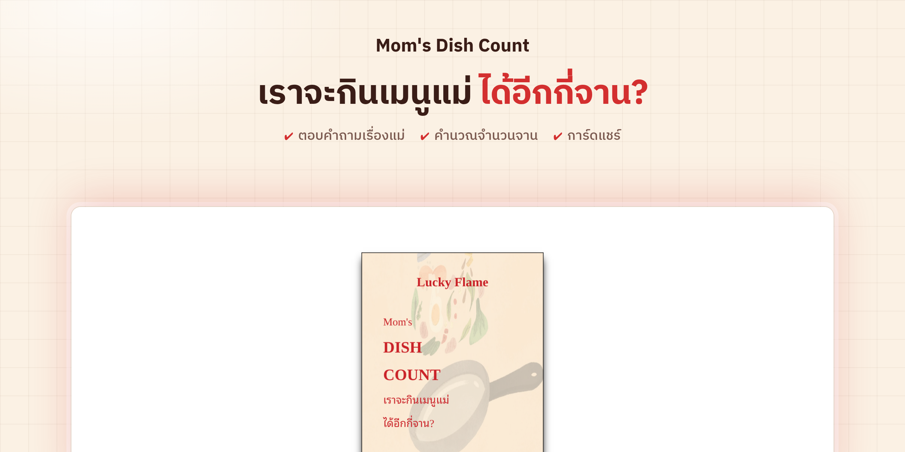

  

  <a href="#ผลงาน">ผลงาน</a> ·
  <a href="#event--campaign">Event / Campaign</a> ·
  <a href="#สิ่งที่เราทำ">สิ่งที่เราทำ</a> ·
  <a href="#ติดต่อ">ติดต่อ</a>

---

PlutoStudio เป็นทีมพัฒนาซอฟต์แวร์จากประเทศไทย ทำตั้งแต่ออกแบบ เขียนระบบ ขึ้น production ไปจนถึงดูแลต่อหลังเปิดใช้งาน
ให้กับมหาวิทยาลัย หน่วยงาน และธุรกิจ

## ผลงาน

<table>
  <tr>
    <td width="50%" valign="top">
      
      <h3>Planriean</h3>
      จัดตารางเรียนสำหรับนักศึกษา เลือกวิชา เช็กเวลาชน รีวิวรายวิชา และดูแผนที่ตึกพร้อมเวลาเดิน 
      <a href="https://www.planriean.com">planriean.com</a>
    </td>
    <td width="50%" valign="top">
      
      <h3>กันไว้ · Kanwai</h3>
      แอปวางแผนการเงินส่วนตัวแบบ self-host กันเงินเดือนนี้ไว้จ่ายบิลเดือนหน้าก่อน แล้วรู้ว่าเหลือใช้เท่าไหร่ แผนรายจ่ายรายเดือน เงินเดือนและภาษีเงินได้
      Subscriptions และหนี้ผ่อน หารบิลกับเพื่อน อ่านสลิปโอนด้วย AI พร้อมแอป Android ที่ส่งสลิปเข้าระบบให้อัตโนมัติ
    </td>
  </tr>
  <tr>
    <td width="50%" valign="top">
      
      <h3>Group Sentinel</h3>
      ผู้ช่วยแอดมินกลุ่ม Facebook ใช้ AI ตรวจโพสต์ คัดกรองคำขอเข้ากลุ่ม พร้อม Insights และ audit log 
      <a href="https://group-sen.plutopon.me">group-sen.plutopon.me</a>
    </td>
    <td width="50%" valign="top">
      
      <h3>WaterWise</h3>
      ระบบข้อมูลน้ำชุมชนระดับจังหวัด แผนที่ภาพรวม ความต้องการใช้น้ำ แหล่งน้ำสำรวจ และน้ำต้นทุน 
      <a href="https://roiet-twc.greendev.app/dashboard">roiet-twc.greendev.app</a>
    </td>
  </tr>
  <tr>
    <td width="50%" valign="top">
      
      <h3>แม่ทองใบอมตะ</h3>
      เว็บร้านทอง แสดงราคาทองวันนี้ สินค้า บริการ โปรโมชั่น และแผนที่สาขา 
      <a href="https://www.maethongbaigold.com/">maethongbaigold.com</a>
    </td>
    <td width="50%" valign="top"></td>
  </tr>
  <tr>
    <td width="50%" valign="top">
      
      <h3>verDDC</h3>
      เว็บเช่าเครื่อง DDC รายวัน/รายสัปดาห์ เติมเงินผ่าน PromptPay พร้อมระบบสั่งเปิด-ปิดเครื่องจากระยะไกล 
      ปิดให้บริการแล้ว
    </td>
    <td width="50%" valign="top">
      
      <h3>IT MSU SHOP</h3>
      ตลาดออนไลน์ "สินค้าดีที่อีสาน" ของวิสาหกิจชุมชนภาคอีสาน ร้านค้าเปิดร้านเอง ไลฟ์ขายสินค้า ชำระด้วยสลิปโอน พร้อมระบบหลังบ้าน 
      ปิดให้บริการแล้ว
    </td>
  </tr>
</table>

## Event / Campaign

<table>
  <tr>
    <td width="50%" valign="top">
      
      <h3>ลอยสุขไปต่อ</h3>
      ลอยกระทงออนไลน์ แต่งกระทงเอง เขียนคำอธิษฐาน เล่นกับเพื่อนได้สูงสุด 4 คน แล้วบันทึกการ์ดไว้แชร์ 
      <a href="https://www.planriean.com/loy">planriean.com/loy</a> · เปิดให้เล่นช่วงวันลอยกระทงทุกปี
    </td>
    <td width="50%" valign="top">
      
      <h3>Mom's Dish Count</h3>
      แคมเปญ Lucky Flame ตอบคำถามเรื่องแม่และเมนูโปรด แล้วคำนวณว่าเราจะได้กินเมนูแม่อีกกี่จาน พร้อมการ์ดผลลัพธ์ไว้แชร์
    </td>
  </tr>
</table>

## สิ่งที่เราทำ

- **เว็บแอป & ระบบหลังบ้าน** — Next.js, React, TypeScript
- **API & ระบบเชื่อมต่อ** — Node.js, Go, Python, เชื่อมระบบเดิมของหน่วยงาน
- **Data & AI** — ดึงและจัดการข้อมูล, ใช้ AI ช่วยคัดกรองและสรุปผล
- **ขึ้นระบบและดูแลต่อ** — Docker, reverse proxy

## ติดต่อ

🌐 [plutopon.me](https://plutopon.me)
